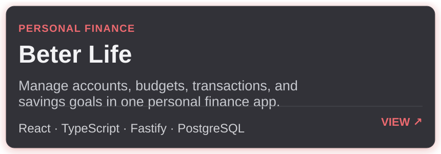
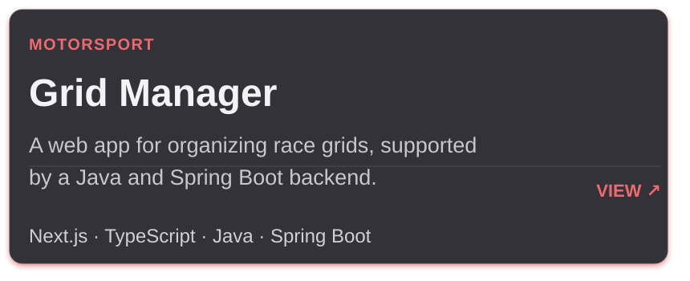
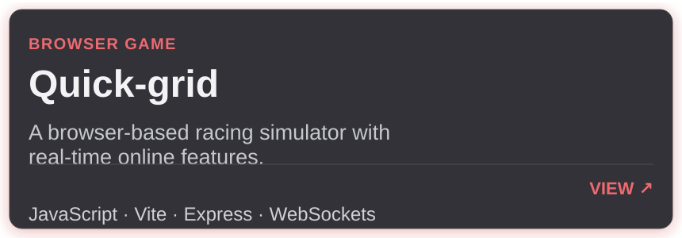
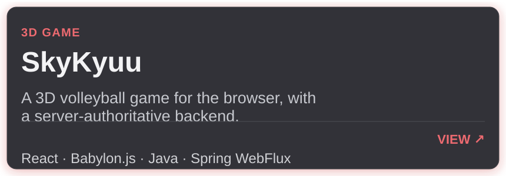

  
  <h1>👋 Hi, I'm Eduardo!</h1>
  
<strong>Software Developer · Web Applications & Games</strong>

  
I build web applications, APIs, and browser games. I enjoy connecting interfaces, business logic, and data to turn ideas into clear, useful products.

  

    
    
  

  

---

## 🧑‍💻 About Me

I work across the full stack, from building interfaces and APIs to integrating databases and creating interactive browser experiences. My recent work includes personal finance, motorsport management, racing simulations, and 3D games.

## 🚀 Projects I Lead

Selected projects from organizations where I have repository administration and maintainer access.

<table>
  <tr>
    <td width="50%" valign="top">
      
 <strong>Beter Life</strong>

      

    </td>
    <td width="50%" valign="top">
      
 <strong>Grid Manager</strong>

      

    </td>
  </tr>
  <tr>
    <td width="50%" valign="top">
      
 <strong>Quick-grid</strong>

      

    </td>
    <td width="50%" valign="top">
      
 <strong>SkyKyuu</strong>

      

    </td>
  </tr>
</table>

## 🧰 Technologies

Technologies I have used across projects, grouped by area.

**Languages & Web**

  
  
  
  
  

**Frontend, Frameworks & Games**

  
  
  
  
  
  

**Backend, Databases & Infrastructure**

  
  
  
  
  
  
  
  
  
  
  

**Testing & Collaboration**

  
  
  
  

## 📈 Contributions

  

  

