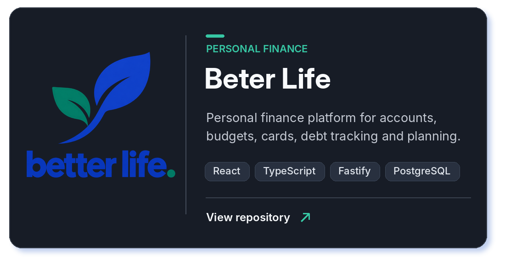
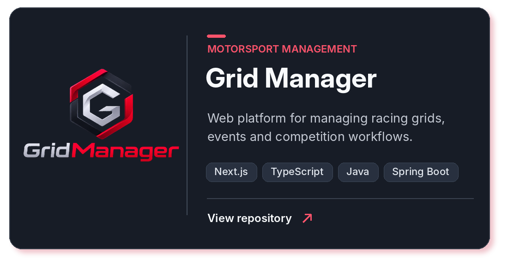
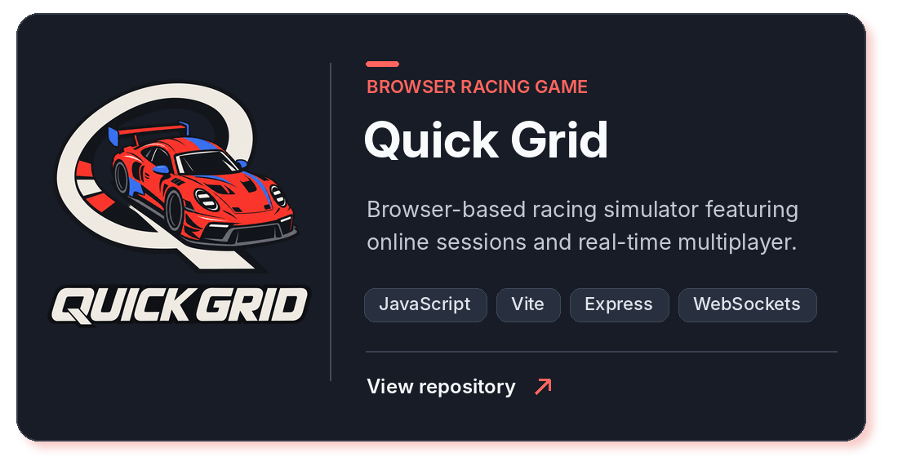
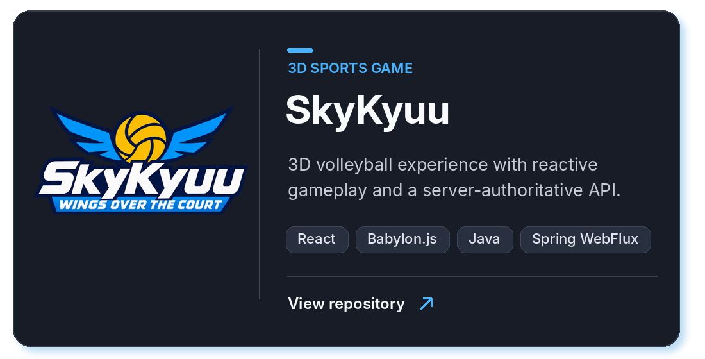

# 👋 Hi, I'm Eduardo!

**Software Developer · Full Stack · Interactive Experiences**

I create web applications, robust APIs, and interactive browser games — from product architecture to the details that make experiences feel polished.

---

## 🧑‍💻 About Me

I build modern interfaces, backend services, and real-time applications. My projects bring together **frontend engineering, API design, data modeling, and game development** — with an emphasis on clear interfaces and maintainable code.

## 🚀 Featured Projects

A selection of projects I lead and maintain, across personal finance, motorsport, racing simulation, and 3D games.

<table>
  <tr>
    <td align="center" width="50%">
      
      <strong>Beter Life</strong>
      

    </td>
    <td align="center" width="50%">
      
      <strong>Grid Manager</strong>
      

    </td>
  </tr>
  <tr>
    <td align="center" width="50%">
      
      <strong>Quick-grid</strong>
      

    </td>
    <td align="center" width="50%">
      
      <strong>SkyKyuu</strong>
      

    </td>
  </tr>
</table>

Click a card to open its repository. Organization logos link to their GitHub pages.

## 🧰 Technologies

<b>Languages & Core Web</b>

 

<b>Frontend & Interactive Experiences</b>

 

<b>Backend, Databases & APIs</b>

 

<b>Testing & Developer Tools</b>

 

## 📈 Contributions

  

---

**Let's build something worth using.**

